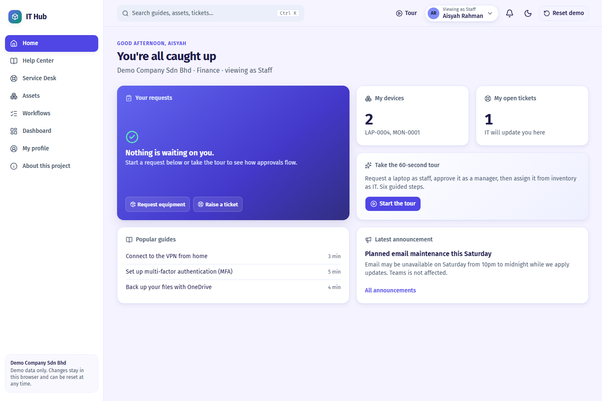
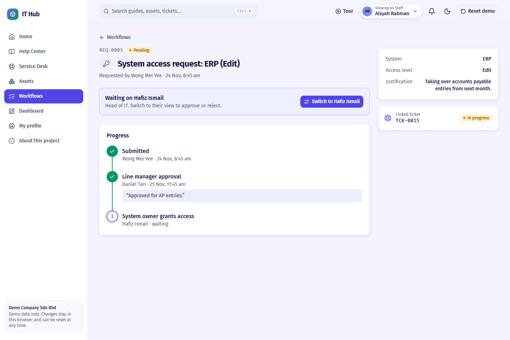
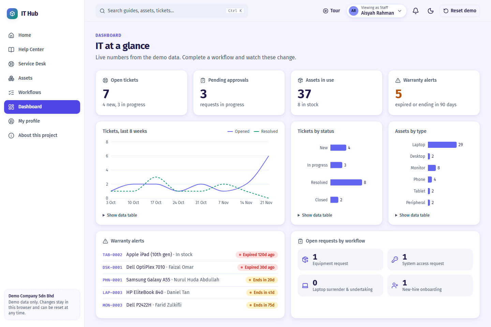
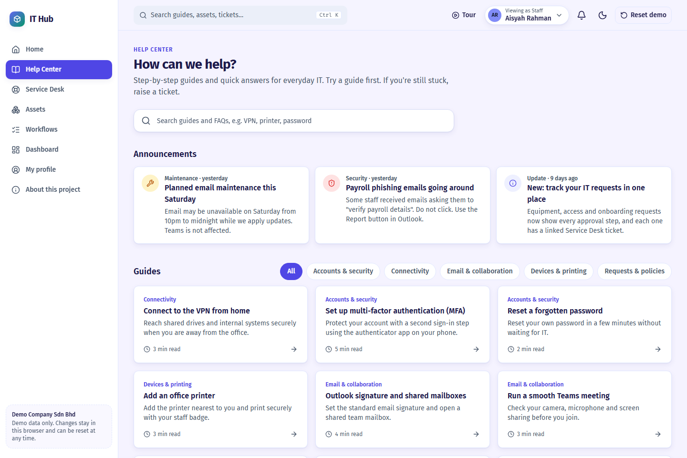
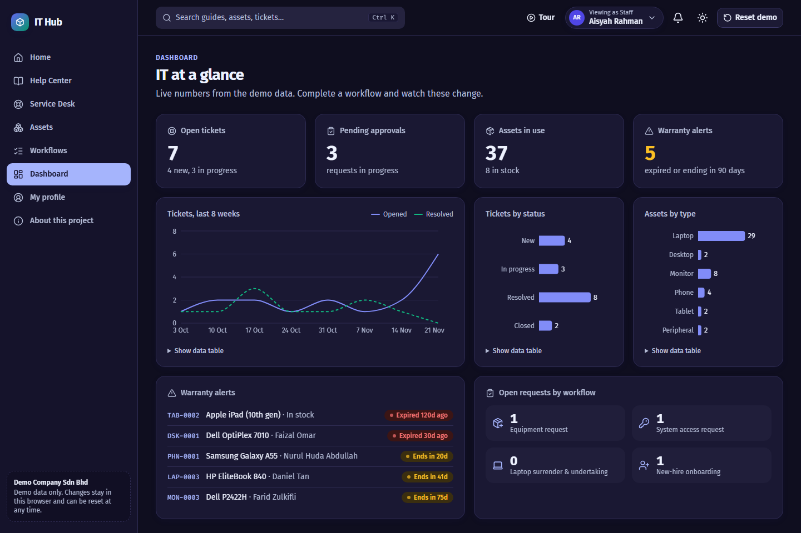

# IT Hub

A clickable demo of a connected IT system: a help center, a service desk, an asset inventory and four approval workflows that all share one set of data.

**Live demo:** https://it-hub-ms.netlify.app/ · **Start straight in the guided tour:** https://it-hub-ms.netlify.app/?tour=start



> A rebuild with fictional data of a system I built at Cypark. No company data is used.

## Try it in 60 seconds

1. Open the [demo](https://it-hub-ms.netlify.app/) and press **Start the tour**, or go straight to [the tour](https://it-hub-ms.netlify.app/?tour=start).
2. As **Aisyah (Staff)**, submit an equipment request for a laptop.
3. Switch to **Daniel (Manager)** and approve it.
4. Switch to **Hafiz (IT Admin)** and assign a laptop from stock.
5. The laptop's history, Aisyah's profile, her linked ticket and the Dashboard all update together.

No sign-up. Everything stays in your browser, and **Reset demo** brings back the original data.

## What's inside

| Area | What it does |
|---|---|
| **Help Center** | 12 step-by-step guides, 10 FAQs, announcements and search. "Still stuck?" opens a ticket with the category filled in. |
| **Service Desk** | Raise, filter and follow tickets. IT sees every ticket; staff see their own. |
| **Asset Inventory** | Every device with owner, site, warranty status and full history. Flags expired or expiring warranties and devices with no owner. |
| **Workflows** | New-hire onboarding, equipment request, laptop surrender & undertaking, and system access. Each routes to the requester's own manager. |
| **Dashboard** | Open tickets, pending approvals, assets in use and warranty alerts, with charts that change as you work. |
| **People & profiles** | Each person's devices, system access, requests and tickets. New hires appear as soon as onboarding completes. |
| **About this project** | The real problem, my role and the real system's architecture. |

## Connected by design

Every workflow writes to shared data instead of ending in an inbox.

- **Equipment request:** the manager approves, IT assigns a device that is actually in stock, and the asset's history records it.
- **Laptop surrender:** IT types the serial number from the device. It must match the inventory record before the laptop goes back to stock (or to repair if damaged).
- **Onboarding:** HR starts it, the department manager approves, and IT completes a checklist that creates the person, their system access and their laptop assignment.
- **System access:** the line manager approves, the system owner grants it, and the system appears on the person's profile.

Each request also opens a **linked Service Desk ticket** that moves to In progress when it reaches IT and resolves itself when the request completes. Requesters with no line manager skip that step automatically.

| | |
|---|---|
|  |  |
|  |  |

## The real system it's based on

At Cypark I built a SharePoint IT Help Center, and I designed the workflows and built a web system that moved about 20 paper forms online with a ticketing system. It runs on AWS with Microsoft 365 single sign-on, uses the Microsoft Graph API to fill in user and organisation data, sends approvers an email link back to the app, and links the hardware inventory to the forms. It is in its demo phase for about 100 users. That system is internal, so this project rebuilds the same ideas in public with fictional data.

| | Real system | This demo |
|---|---|---|
| Sign-in | Microsoft 365 SSO | Role switcher |
| Data | Database on AWS | Your browser, with Reset |
| Approvals | Email link back to the app | In-app notifications |
| Scope | ~20 forms + tickets, ~100 users | 4 workflows, tickets, inventory, help center |

## How it's built

- **React 19 + TypeScript + Vite**, styled with **Tailwind CSS** and **shadcn/ui** (Radix), charts with **Recharts**, icons from **Lucide**.
- **All business rules are pure functions** in `src/domain/` (`workflows.ts`, `assets.ts`, `tickets.ts`, `stats.ts`). They take the current state and return a new one or an error message, so they are easy to test and the UI holds no logic.
- A single **Zustand** store wraps those functions and saves to `localStorage`. If saved data is broken or from an old version, or storage is blocked, the app falls back to fresh demo data in memory.
- Demo dates are generated **relative to today**, so warranty alerts and the 8-week ticket trend always look current.
- **Accessibility:** keyboard navigable, visible focus, labelled controls, errors next to their fields, a data table behind every chart, light and dark themes, and reduced-motion support. Lighthouse on the live site: performance 90–95, accessibility 100, best practices 100.
- **Tests:** 105 Vitest + Testing Library tests, including the full equipment flow and the guided tour clicked through the real UI.

```
src/
  domain/      business rules + seed data (pure, unit tested)
  store/       Zustand store with safe localStorage persistence
  content/     help center guides, FAQs, announcements
  components/  layout, shared UI, charts, workflow pieces
  pages/       one file per route
  tour/        guided tour steps, provider and overlay
```

## Run it locally

```bash
npm install
npm run dev        # http://localhost:5173
npm test           # unit and UI tests
npm run build      # production build in dist/
```

Deployed on Netlify (`netlify.toml`, with `public/_redirects` for client-side routes).

---

Built by Haikal Fitri · [Portfolio](https://haikalfitri.github.io/Portfolio/) · [MIT License](LICENSE)
